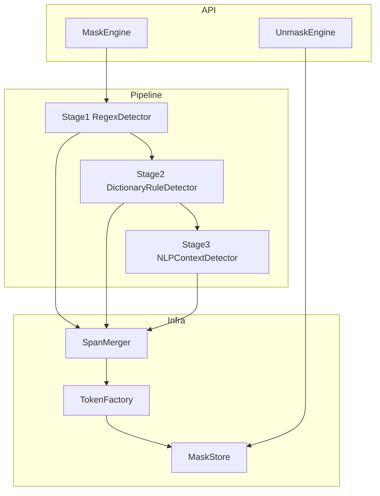
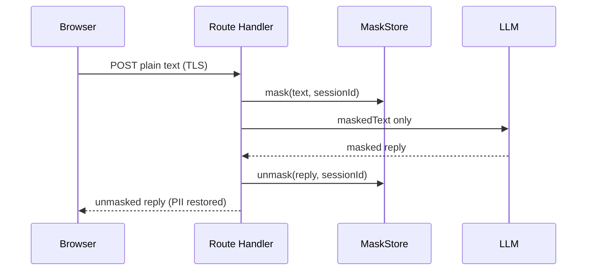

# local-mask-security 設計書

## 1. 概要

### 1.1 目的

LLM（大規模言語モデル）へテキストや構造化データを送る前に、個人を特定しうる情報（PII: Personally Identifiable Information）を検出・置換（マスク）し、LLM 応答を受け取った後に同一セッション内で元の値へ復元（アンマスク）するライブラリを提供する。

対象例（初期スコープ）:

| カテゴリ | 例 |
|----------|-----|
| 氏名 | 漢字・かな・ローマ字 |
| 住所 | 都道府県〜番地、郵便番号 |
| 電話番号 | 固定・携帯・国番号付き |
| 生年月日 | `YYYY-MM-DD`、和暦、日本語表記 |
| マイナンバー | 12 桁（チェックディジット考慮） |
| アカウント ID | 社内 ID、UUID、ログイン名 |
| パスワード | 平文らしき文字列（ヒューリスティック） |
| メールアドレス | RFC 5322 簡易 |

### 1.2 非目的（初期版）

- LLM プロバイダーへの API ラッパー（呼び出し自体はアプリ側）
- 永続的な PII の暗号化アーカイブ（セッション内マッピングのみ）
- 100% の検出保証（多段パイプラインでリスク低減を目指す）

### 1.3 利用形態

- **コア**: フレームワーク非依存の TypeScript パッケージ（Node / Edge / ブラウザ）
- **React**: フックと Context によるセッション管理
- **Next.js**: App Router / Pages Router 双方で `import` 可能（SSR・Server Actions・Route Handlers でサーバー側マスクを推奨）

```
┌─────────────────────────────────────────────────────────────┐
│                     アプリケーション (Next.js)                 │
│  UI (React) ──► useMaskSession / MaskProvider               │
│  Server ──────► createMaskEngine().mask()                   │
└──────────────────────────┬──────────────────────────────────┘
                           │
┌──────────────────────────▼──────────────────────────────────┐
│              @local-mask-security/core                       │
│  Pipeline: Regex → Dictionary/Rule → NLP (context)         │
│  MaskStore: token ↔ 原文（セッションスコープ）                 │
└─────────────────────────────────────────────────────────────┘
```

---

## 2. 要件

### 2.1 機能要件

1. **マスク**: 入力文字列（または JSON フィールド）を走査し、検出 span をプレースホルダに置換する。
2. **アンマスク**: プレースホルダを含む LLM 出力を、同一 `sessionId` のマッピングで復元する。
3. **3 段パイプライン**（順序固定）:
   - Stage 1: 正規表現
   - Stage 2: 辞書・ルール
   - Stage 3: NLP（文脈ベース）
4. **設定**: カテゴリの ON/OFF、カスタム regex、カスタム辞書、NLP 閾値。
5. **監査**: マスク件数・カテゴリ別ヒット（原文はログに出さないオプション）。

### 2.2 非機能要件

| 項目 | 方針 |
|------|------|
| パフォーマンス | 長文はチャンク分割 + Stage 1/2 を優先；NLP はオプション |
| 再入可能性 | 同一入力・同一設定なら決定的な token 生成（オプションでランダム salt） |
|  Tree-shaking | カテゴリ・Stage をサブパス export |
| Next.js | `"use client"` は React 層のみ；core は isomorphic |
| 秘密情報 | MaskStore はメモリ默认；必要時のみ暗号化バックエンド |

---

## 3. アーキテクチャ

### 3.1 パッケージ構成（モノレポ案）

```
local-mask-security/
├── packages/
│   ├── core/                 # マスクエンジン本体
│   ├── react/                # hooks, Provider, 型再export
│   └── patterns/             # 国・ロケール別 regex / 辞書（optional）
├── apps/
│   └── example-next/         # デモ App Router
└── docs/
    └── DESIGN.md
```

公開名（案）:

- `@local-mask-security/core`
- `@local-mask-security/react`
- `@local-mask-security/patterns-ja`

### 3.2 レイヤー



---

## 4. コア概念

### 4.1 Span（検出区間）

```ts
type PiiCategory =
  | "email"
  | "phone"
  | "address"
  | "name"
  | "birthdate"
  | "my_number"
  | "account_id"
  | "password"
  | "custom";

interface DetectedSpan {
  start: number;       // UTF-16 index（JS 文字列と一致）
  end: number;
  category: PiiCategory;
  confidence: number;  // 0..1
  source: "regex" | "dictionary" | "rule" | "nlp";
  meta?: Record<string, unknown>;
}
```

### 4.2 マスクトークン形式

LLM が改変しにくく、パース可能で、カテゴリが分かる形式:

```
⟦MSK:{sessionShort}:{category}:{seq}⟧
```

例: `⟦MSK:a1b2:email:0007⟧`

- **角括弧風 Unicode**（`⟦` `⟧`）: 通常の Markdown / JSON と衝突しにくい
- `sessionShort`: セッション識別（8 文字）；フル `sessionId` は Store のキー
- `seq`: セッション内 monotonic 整数
- **禁止**: 原文の部分文字列を token に含めない

MaskStore 内部:

```ts
interface MaskEntry {
  token: string;
  original: string;
  category: PiiCategory;
  hashedOriginal?: string; // 監査用（SHA-256）
}
```

### 4.3 パイプライン実行モデル

1. 入力文字列 `text` を受け取る。
2. Stage 1〜3 がそれぞれ **Span リスト**を返す（テキストはまだ変更しない）。
3. **SpanMerger** が重複・競合を解決する（後述）。
4. 末尾から `start` 降順で置換（インデックスずれ防止）。
5. 各置換で MaskStore に登録し、token を挿入。
6. 結果: `{ maskedText, stats, sessionId }`。

アンマスク:

1. 正規表現 `⟦MSK:...⟧` で token を列挙。
2. Store から `original` を取得；欠落 token は `{ preserveToken | throw | placeholder }` ポリシー。
3. 置換後 `{ unmaskedText, missingTokens[] }`。

---

## 5. 三段階検出の詳細

### 5.1 Stage 1: 正規表現

**役割**: 構造が明確な PII を高速に検出（メール、電話、郵便番号、マイナンバー、ISO 日付など）。

**設計**:

- カテゴリごとに `RegExp[]`（フラグ `gu`）。
- パターンは `@local-mask-security/patterns-ja` に集約し、core は DI で注入。
- **Lookbehind / lookahead** で URL 内メールやファイルパス誤検知を削減。
- 各 match に `confidence: 0.95`（固定またはパターン別）。

**例（概念）**:

| category | 概要 |
|----------|------|
| email | ローカル@ドメイン |
| phone | 0\d{9,10}, +81 形式 |
| my_number | 4-4-4 または 12 桁連続 + チェック |
| birthdate | `\d{4}[-/年]\d{1,2}[-/月]\d{1,2}` 等 |

**出力**: `source: "regex"` の Span 配列。

### 5.2 Stage 2: 辞書・ルールベース

**役割**: 組織固有名詞、禁止語リスト、項目ラベル近傍の値（「氏名：山田太郎」）、カスタム ID 形式。

**構成**:

1. **辞書 (Dictionary)**
   - `Map<string, PiiCategory>` または trie。
   - 完全一致・大文字小文字無視・正規化（NFKC、全角半角）。
   - 長いキー優先（「山田太郎」>「山田」）。

2. **ルール (Rules)**
   - 宣言的 DSL または JSON Rule:

```ts
interface MaskRule {
  id: string;
  category: PiiCategory;
  // ラベル検出 + 値キャプチャ
  labelPattern?: RegExp;   // 例: /(?:氏名|お名前)[:：\s]*/
  valuePattern?: RegExp;   // 例: /[\p{Script=Han}]{2,10}/u
  maxValueLength?: number;
  confidence: number;
}
```

3. **実行順**
   - 辞書スキャン（Aho-Corasick 等で長文対応）
   - ルール適用（ラベル位置から value span を計算）

**既マスク領域**: Stage 1 後の text ではなく **原文**上で span を取り、Merger で統合（Stage 1 が token に置換済みの中間表現を使う方式も可 — 実装では **原文一貫**方式を推奨: 全 Stage が原文インデックスで span を返し、最後に一括置換）。

**推奨**: 全 Stage は **常に原始入力**に対して span 検出 → Merger → 一括マスク（中間 token 化による regex 欠落を防ぐ）。

### 5.3 Stage 3: NLP 文脈ベース

**役割**: 「田中さんが」「東京都渋谷区」など regex/辞書で漏れる固有表現、役割・文脈からの PER/LOC/ORG。

**制約（ブラウザ / Edge）**:

- 重量級 transformers はサーバー向け；クライアントは WASM / 小型モデル / **外部 API** をプラuggable に。

**インターフェース**:

```ts
interface NlpDetector {
  detect(text: string, options: NlpOptions): Promise<DetectedSpan[]>;
}

interface NlpOptions {
  locale: "ja" | "en";
  minConfidence: number;
  categories?: PiiCategory[]; // name, address に限定等
}
```

**実装オプション**:

| 実装 | 実行場所 | 備考 |
|------|----------|------|
| `nlp-stub` | 任意 | 開発用；ヒューリスティック |
| `nlp-server` | Node Route Handler | `@huggingface/transformers` 等 |
| `nlp-remote` | API | 社内 NER サービス |

**文脈ルール（NLP 補助）**:

- 固有名詞タグ `PER` → `name`
- `LOC` + 住所辞書 → `address`
- 前後トークンに「パスワード」「PW」→ 後続文字列を `password`（confidence 調整）

**confidence**: モデル出力確率 × カテゴリマッピング重み；Merger で Stage 1/2 より低い場合は上書きしない（デフォルト）。

---

## 6. Span マージポリシー

同一 `[start, end)` の重複・部分重複を解決する。

**優先順位（默认）**:

1. **ソース**: regex > dictionary > rule > nlp
2. 同ソースなら **confidence 降順**
3. 同点なら **span 長さ降順**
4. 包含関係: 高優先 span が低優先を吸収（子 span 破棄）

**部分重複**（例: メール全体 vs `@` 以降）:

- 高優先が勝つ；残り区間は再評価しない（一括 greedy）。

**カテゴリ競合**（同一区間で email vs account_id）:

- 優先表を設定可能（默认: より具体的な pattern の confidence）。

```ts
interface MergePolicy {
  sourcePriority: Record<DetectedSpan["source"], number>;
  categoryPriority?: Partial<Record<PiiCategory, number>>;
  minConfidence: number;
}
```

---

## 7. 公開 API（core）

### 7.1 エンジン生成

```ts
import { createMaskEngine } from "@local-mask-security/core";

const engine = createMaskEngine({
  locale: "ja",
  sessionId: crypto.randomUUID(), // 省略時は自動生成
  stages: {
    regex: true,
    dictionary: true,
    nlp: false, // 默认 OFF（レイテンシ）
  },
  patterns: jaPatterns,
  dictionary: myDictionary,
  rules: myRules,
  nlp: nlpDetector,
  mergePolicy: defaultMergePolicy,
  onAudit: (event) => { /* 件数のみ */ },
});

const { maskedText, sessionId, stats } = await engine.mask("...");

const { unmaskedText } = engine.unmask(maskedLlmResponse);
// または session 跨ぎ: createUnmaskEngine(store).unmask(text, sessionId)
```

### 7.2 構造化データ

```ts
await engine.maskJson(userPayload, {
  paths: ["$.profile.email", "$.messages[*].content"],
  maskStringFields: ["name", "address"],
});
```

- JSON Path または key 名リストで文字列フィールドのみ再帰マスク。
- 配列・ネスト対応；token は同一 session store。

### 7.3 MaskStore のライフサイクル

| 実装 | 用途 |
|------|------|
| `InMemoryMaskStore` | 默认；プロセス内 Map |
| `EncryptedMaskStore` | AES-GCM + TTL |
| `RedisMaskStore` | 将来；サーバー集群 |

**TTL**: 默认 30 分；Next.js では Route Handler 内で sessionId を HttpOnly Cookie に紐付け可能。

---

## 8. React / Next.js 統合

### 8.1 React パッケージ

```tsx
"use client";

import { MaskProvider, useMaskSession } from "@local-mask-security/react";

function Chat() {
  const { mask, unmask, sessionId } = useMaskSession();

  async function sendToLlm(text: string) {
    const { maskedText } = await mask(text);
    const reply = await fetch("/api/chat", {
      body: JSON.stringify({ maskedText, sessionId }),
    });
    const { content } = await reply.json();
    return unmask(content);
  }
}
```

- `MaskProvider`: Engine + Store を Context で保持。
- **注意**: Store をクライアントのみに置く場合、sessionId をサーバー LLM プロキシへ渡し、**サーバー側に Store レplica が無い**とサーバーで unmask 不可 → **マスク/アンマスクを同一ランタイムで行う**か、Store を Redis 等で共有。

### 8.2 Next.js 推奨フロー（サーバーマスク）



- PII は LLM 境界をマスク済みテキストのみ越える。
- `sessionId`: Cookie または server-side session。

### 8.3 バンドル分割

- `core`: `"sideEffects": false`
- `react`: peerDependencies `react >= 18`
- Next.js `transpilePackages` に monorepo パッケージ名を追加

### 8.4 Edge Runtime

- NLP Stage は Edge 非対応の場合あり → `runtime: "nodejs"` の Route または NLP OFF。
- regex + dictionary のみなら Edge 可。

---

## 9. セキュリティ設計

1. **最小送信**: LLM には maskedText のみ。
2. **Store 分離**: sessionId ごとに Map；推測困難な UUID。
3. **ログ**: 默认 `original` をログしない；`onAudit` は category + count。
4. **トークン推測**: seq は整数だが sessionShort が秘匿；総当たり不可想定。
5. **残留リスク**: LLM が token を改変 → unmask 失敗；**検証**で欠落 token を検出し再試行またはエラー表示。
6. **辞書漏洩**: 辞書自体に PII を含む場合、ビルド成果物に載る — 環境変数 / サーバー側ロード推奨。
7. **パスワード**: 検出しても **マスクのみ**；Store に平文保存は TTL 短縮 + EncryptedStore 推奨。

---

## 10. 設定例

```ts
const engine = createMaskEngine({
  locale: "ja",
  categories: {
    email: true,
    phone: true,
    address: true,
    name: true,
    birthdate: true,
    my_number: true,
    account_id: true,
    password: true,
  },
  stages: { regex: true, dictionary: true, nlp: true },
  mergePolicy: { minConfidence: 0.6 },
  nlp: { minConfidence: 0.75, categories: ["name", "address"] },
});
```

---

## 11. テスト戦略

| 層 | 内容 |
|----|------|
| Unit | 各 regex、辞書、Merger、Token 往返 |
| Golden | 固定入力 → masked スナップショット（原文は repo 外 fixtures） |
| Property | roundtrip: `unmask(mask(x))` の可視文字が x と一致（token 以外） |
| E2E | example-next: API Route 経由で LLM モック |

---

## 12. 実装フェーズ

| Phase | 内容 |
|-------|------|
| **P0** | monorepo、core mask/unmask、Stage1 regex、InMemoryStore、単体テスト |
| **P1** | Stage2 辞書・ルール、Merger、maskJson |
| **P2** | `@local-mask-security/react`、example-next |
| **P3** | Stage3 NLP プラグイン（Node 実装 + stub） |
| **P4** | EncryptedStore、監査イベント、パフォーマンス（Aho-Corasick） |

---

## 13. 未決事項・拡張

- [ ] マイナンバー: チェックディジット算法の厳格度
- [ ] 氏名: 一般名詞除外リスト（「日本」「東京」）
- [ ] 多言語: `patterns-en` パッケージ
- [ ] 部分マスク（下 4 桁残す） vs 完全置換
- [ ] LLM 向け system prompt に token 形式の説明を自動付与するヘルパー

---

## 14. 参考インターフェース一覧

```ts
// packages/core/src/types.ts（要約）

export interface MaskResult {
  maskedText: string;
  sessionId: string;
  stats: MaskStats;
}

export interface MaskEngine {
  mask(text: string): Promise<MaskResult>;
  maskJson<T>(value: T, options?: MaskJsonOptions): Promise<{ value: T; sessionId: string; stats: MaskStats }>;
  unmask(text: string): UnmaskResult;
}

export interface CreateMaskEngineOptions {
  locale: "ja" | "en";
  sessionId?: string;
  store?: MaskStore;
  stages?: Partial<{ regex: boolean; dictionary: boolean; nlp: boolean }>;
  patterns?: PatternBundle;
  dictionary?: Dictionary;
  rules?: MaskRule[];
  nlp?: NlpDetector;
  mergePolicy?: MergePolicy;
  categories?: Partial<Record<PiiCategory, boolean>>;
  onAudit?: (event: AuditEvent) => void;
}
```

---

本設計は **React / Next.js から import 可能な PII マスキングライブラリ**のコア処理（正規表現 → 辞書・ルール → NLP）と、セッション型アンマスク機構を定義する。実装時は P0 から順に進め、NLP はプラグインとして遅延読み込みすることで Next.js のクライアントバンドルサイズを抑える。
